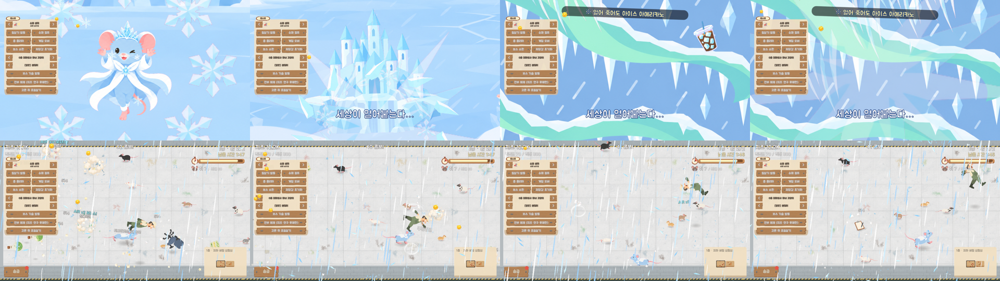

# 얼음쥐 초필살기 「영원한 겨울」 — 현재 연출 스토리보드

작성일: 2026-10-19 · 대상: 아이스 퀸 쥐 / `icequeen` / 초필살기 ID `31015`

## 1. 문서 목적과 확인 범위

현재 구현된 연출을 기획·아트·개발이 같은 순서로 검토할 수 있도록 기록한다. 신규 연출 제안서가 아니라 **현재 상태를 정리한 스토리보드**다. 코드나 게임 수치는 변경하지 않았다.

확인 자료는 저장된 Game 씬 설정, 컷신 생성 스크립트, 재생·공격 처리 코드, 캐릭터 테이블, 기존 플레이 캡처다. 이번 작업에서 Unity를 새로 실행하거나 소리를 직접 청취하지는 않았다. 모든 시간은 발동 순간을 0초로 둔 연출 내부 타임라인 기준이다. 캡처는 장면 확인용으로 사용한다.

## 2. 연출 한 줄 요약

**얼음 여왕이 언 호수에서 거대한 얼음성을 소환하고, 성에서 솟아오른 눈보라가 화면을 뒤덮은 뒤 실제 전장으로 이어져 우박 10타와 마지막 일격을 가한다.**

감정 흐름: 차가운 전조 → 소환의 자신감 → 거대한 성의 충격 → 하늘을 장악하는 눈보라 → 전장을 덮는 공격 → 꽁꽁 얼어붙은 여운.

배경·캐릭터·소품·효과를 분리한 플랫 그림을 합성한다. 큰 파노라마의 이동·확대·회전과 캐릭터 동작 프레임 교체로 움직임을 만든다. 일반 필살기 「렛잇고」와 구분한다.

## 3. 전체 타임라인

시간 기준은 발동 순간 0.00초부터 연출 종료 7.10초까지의 내부 타임라인이다. 모든 컷, 전환, 공격 시점을 이 기준으로 표기한다.

| 구간 | 내부 시간 | 역할 |
|---|---:|---|
| 진입 | 0.00–0.40초 | 전장에서 컷신으로 진입 |
| 컷 1–6 | 0.40–3.40초 | 오로라 → 소환 → 얼굴 → 성 낙하 → 눈보라 상승 → 우박 |
| 컷신 걷힘 | 3.40–3.80초 | 하얀 화면에서 전장으로 연결 |
| 전장 우박 | 3.80–6.80초 | 3초간 다단 10타 |
| 마지막 일격·종료 | 6.80–7.10초 | 강한 충돌, 마무리 문구, 종료 |

내부 타임라인 전체 길이는 **7.10초**다. 별도의 피니시 포즈 컷은 없다.

## 4. 컷별 스토리보드

| 컷 | 내부 시간 | 화면 구성·동작 | 카메라·전환 | 효과·문구·공격 |
|---|---|---|---|---|
| 0. 진입 | 0–0.40초 | 전장 위로 초필살기 진입 연출. 제목 「영원한 겨울」 소개. | 화면 전체 컷신 진입. | 진입음 `jgl_ult_cutin`. 아직 다단 피해 없음. |
| 1. 겨울의 전조 | 0.40–0.85초 | 오로라가 흐르는 하늘. 큰 눈송이가 모여들며 차가운 세계를 제시한다. | 하늘에서 아래로 빠르게 틸트. 줌 1.25→1.10, 기울기 +4°→−2°. | 세로 속도선, 회전하며 모이는 눈송이 6개. 컷인음 `superjump_charge`. |
| 2. 얼음성 소환 | 0.85–1.40초 | 언 호수 위 여왕. 낮게 웅크린 자세에서 두 앞발을 하늘로 들어 올린다. | 호수 하단의 여왕을 확대. 줌 1.70→1.90, 짧은 흔들림. | 서리 오라가 커지고 눈송이가 위로 솟는다. `anim_land_2`→`anim_dash_2`. 제목 띠는 0.95초에 빠지도록 설정. |
| 3. 여왕의 얼굴 | 1.40–1.90초 | 여왕의 얼굴을 크게 잡아 소환의 주체를 강조한다. 얼굴과 배경은 별도 레이어. | 클로즈업 줌. 전환 순간 흰 플래시. | 얼굴 주변 눈송이 회전. `face_close` + `face_bg`. |
| 4. 얼음성 강림 | 1.90–2.50초 | 빈 호수 위로 거대한 얼음성이 떨어져 내려앉는다. 여왕은 오른쪽 아래에 작게 배치되어 크기 대비를 만든다. | 호수 아래쪽을 중심으로 고정에 가까운 미세 줌 1.25→1.32. 착지 순간 강한 흔들림·회전. | **2.22초 착지.** 충격광, 팽창하는 원형 파동, 얼음 파편 10개. 배경이 얼어붙은 판으로 전환. 내부 1.90초부터 대사 「세상이 얼어붙는다…」. 성 착지 자체에는 별도 공격 판정이 없음. |
| 5. 눈보라 상승 | 2.50–3.00초 | 얼어붙은 파노라마의 성에서 눈보라가 하늘로 솟구친다. | 성에서 하늘로 위쪽 틸트. 줌 1.50→1.25, 기울기 −3°→+3°. | 상승하는 얼음 줄기와 눈송이. 상단 밈 소품·문구 「얼어 죽어도 아이스 아메리카노」가 캡처에서 확인됨. |
| 6. 하늘을 덮는 우박 | 3.00–3.40초 | 하늘 가득 얼음 조각과 우박이 비스듬히 떨어진다. 밝기가 높아져 화면이 하얗게 덮인다. | 하늘을 향한 줌 인과 짧은 흔들림. | 얼음 조각 22개와 낙하 궤적. 내부 3.15초부터 화이트아웃이 강해진다. 이 구간도 컷신 표현이며 다단 공격은 뒤에서 시작. |
| 7. 전장으로 연결 | 3.40–3.80초 | 하얀 컷신이 걷히며 원래 게임 화면이 드러난다. 눈보라의 원인이던 성과 실제 공격을 연결한다. | 컷신 레이어 페이드아웃. 새 피니시 그림으로 전환하지 않는다. | 컷신의 우박에서 전장 우박 오버레이로 연결. |
| 8. 전장 우박 10타 | 3.80–6.80초 | 전장 전체로 우박이 내린다. 바닥에서 알갱이가 튀고 공격 대상 위치에 충돌 효과·피해 숫자가 나타난다. | 게임 화면 유지. 타격에 따른 흔들림. | 3초 동안 10타. 0.30초 간격, 첫 타는 시작 후 0.15초. 화면 안 고양이·보스·사람 빙결을 주기적으로 갱신. 다단음 `hit_glass`. |
| 9. 마지막 일격·여운 | 6.80–7.10초 | 대상 위치에 더 큰 우박 충돌과 중앙 충돌 효과. 전장이 다시 안정된다. | 별도 피니시 컷 없이 전장 위에서 마무리. | 마지막 일격, 흰 플래시 0.45, 「전부 꽁꽁!!」, `wall_blast`. 0.30초 뒤 연출 종료. 빙결은 종료 뒤 약 1.5초 여운을 주도록 갱신하는 방식. |

## 5. 플레이 캡처 대조

아래는 기존 플레이 확인 시 저장된 이미지다. 새 스토리보드 그림이 아니라 현재 연출의 시각 근거다. 개발용 메뉴와 HUD가 함께 찍혀 있다.

읽는 순서: 윗줄 왼쪽부터 여왕 → 얼음성 → 상공 눈보라·밈 → 우박, 아랫줄은 전장 우박 진행이다. 이 묶음은 모든 컷의 시작·끝이나 최종 일격을 빠짐없이 담은 자료는 아니다.

우박 그림과 전장 연결을 비교할 보조 캡처: [icequeen_v3_hail.png](../UnityResources/Rats/SuperUlt/preview/icequeen_v3_hail.png).

## 6. 연출과 실제 게임 처리의 연결

- 공격 타이밍: 성이 떨어질 때 피해를 주는 구조가 아니다. 컷신이 완전히 걷힌 뒤 전장 구간에서 10타와 마지막 일격을 처리한다.
- 다단 피해 설정: 기본 피해 기준 `hit_mul=4` × 10회, 마지막 일격 `finish_mul=20`. 보스 상한과 대상 상태가 적용되므로 화면 숫자를 그대로 합산한 값을 이 배율만으로 단정하지 않는다.
- 피해 표시는 대상별 월드 팝업이다. 현재 `hitNumbers=0`이므로 이전 버전의 컷신 위 지정 위치 숫자를 기준으로 삼지 않는다.
- 우박은 그림 에셋을 사용한다. 낙하 알갱이·큰 덩어리·바닥 충돌 3프레임을 조합한다. 충돌 프레임 간격 0.07초, 크기 설정은 바닥 90px / 대상 타격 220px / 마지막 일격 420px.
- 빙결은 전장 우박 단계에서 화면 안 생명체에 반복 적용한다. 종료 후 잔여 시간은 갱신 주기와 대상 진입 시점에 따라 달라질 수 있다.
- 사운드는 씬에 연결된 키를 기록했다. 컷 4의 성 착지에 전용 착지음이 동기화되었다고 확인한 것은 아니다.

## 7. 현재 버전 판별과 검토할 지점

**현재 버전:** 6컷 소환 컷신 + 전장 우박. 얼음성은 하늘에서 내려오고, 눈보라는 성에서 위로 솟은 뒤 전장으로 떨어진다.

**이전 버전과의 구분:** 활강·회전 중심 8컷, 고드름 10타에 화면 균열이 쌓이는 연출, 마지막에 유리가 산산조각 나는 피니시는 현재 기준이 아니다. 해당 이미지나 오래된 기록을 최신 스토리보드와 혼용하지 않는다.

검토 시에는 ① 성 착지의 무게감 ② 성→상공→전장 우박의 연결이 읽히는지 ③ 화이트아웃 후 대상·피해 숫자의 가독성 ④ 마지막 일격 문구가 충분히 보이는지 ⑤ 제목과 밈이 주요 동작을 가리지 않는지를 확인한다. 이는 검토 항목이며 이번 문서화에서 변경한 내용은 없다.

## 8. 근거 파일

| 자료 | 확인 내용 |
|---|---|
| [superult_story.py](../Tools/superult_story.py) `icequeen()` 및 `WORLD`, `IMAGE_FX` | 6컷 구성, 카메라 키, 착지 시각, 우박, 내부 시각 |
| [Game.unity](../Unity_Making/NKK_Project/Assets/Scenes/Game.unity) `code: icequeen` | 실제 저장된 스타일: actEnd 3.4, cutFade 0.4, worldTime 3, freezeAll 1.5, 효과·사운드 |
| [SuperUltManager.cs](../Unity_Making/NKK_Project/Assets/Scripts/Ults/SuperUltManager.cs) | 내부 타임라인, 전장 단계 전환, 10타·마무리, 피해 표시·빙결 |
| [RatTable.json](../Unity_Making/NKK_Project/Assets/Data/RatTable.json) `Super_Ult:31015`, `Super_Config` | 기술명, 대사, 히트 수·배율 |
| [gen_superult_scene.py](../Tools/gen_superult_scene.py) | 스타일·제목 종료 시각 생성 |
| [HANDOFF.md](../HANDOFF.md) §5-14 | 버전 변경 이력과 기존 Play 확인 기록 |

충돌하는 기록이 있을 때는 현재 저장된 씬 설정과 실행 코드를 우선했다. 특히 생성 함수의 오래된 주석에 적힌 일반 필살기 변경 내용은 최신 상태의 근거로 사용하지 않았다.

